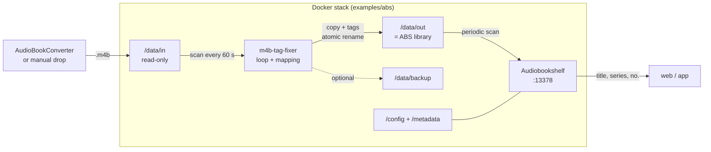

# m4b-tag-fixer

[](https://github.com/yasuoiwakura/audiobook-tag-rewriter/actions/workflows/docker.yml)
[](https://github.com/yasuoiwakura/audiobook-tag-rewriter/pkgs/container/audiobook-tag-rewriter)
[](LICENSE)
[](https://www.python.org/)

`m4b-tag-fixer` is a batch CLI tool that rewrites MP4 metadata in `.m4b`
audiobook files so that **Audiobookshelf (ABS)** correctly imports the title,
author, narrator, series, and series sequence. It is intended as a preprocessing
step for **AudioBookConverter** output.

The project is called `m4b-tag-fixer`; the published container image is called
`audiobook-tag-rewriter`.

- [The Problem](#the-problem)
- [The Solution](#the-solution)
- [Quick Start](#quick-start)
- [Audiobookshelf Stack](#audiobookshelf-stack)
- [Architecture](#architecture)
- [Configuration](#configuration)
- [Operations](#operations)
- [Limits and Safety](#limits-and-safety)
- [Development](#development)
- [Documentation](#documentation)
- [Support](#support)
- [License](#license)

## The Problem

AudioBookConverter typically writes series audiobooks with this semantics:

- `album` = series
- `track` = series sequence
- `title` = book title

For M4B files, Audiobookshelf interprets `album` as the book title and `track` as
the track/chapter. The ffprobe-based scanner only reads the series and series
sequence from `show` and `episode_id`, which come from the MP4 atoms `tvsh` and
`tven`.

In addition, ABS invokes ffprobe **without** `-export_all`. As a result, the
actually appropriate atoms `mvnm`/`mvin` are invisible to ABS for MP4/M4B. The
outcome: wrong book title, empty series, empty series sequence.

The full problem, root-cause, and alternatives analysis is in
[`doc/PROBLEM.md`](doc/PROBLEM.md). The upstream issue draft is in
[`ABS-issue-readtags.md`](ABS-issue-readtags.md).

## The Solution

The fixer copies the file and rewrites the tags. The audio data is not re-encoded.

Without `TAG_MAP` and without `TAG_RULES`, this default mapping applies:

| Source | Target | MP4 atoms | Meaning |
| --- | --- | --- | --- |
| `album` | `series` | `tvsh`, `mvnm` | Album is copied to series |
| `track` | `series-part` | `tven`, `mvin` | Track number becomes series sequence |
| `title` | `album` | `©alb` | Book title is set as album |

`tvsh`/`tven` are visible to ABS and ffprobe (`show`/`episode_id`).
`mvnm`/`mvin` are written as well so other players can find them. `mvin` remains
a real integer atom.

Important:

- Mappings **copy** values; the source remains, the target is overwritten.
  `title -> album` therefore intentionally overwrites the previous album after it
  has been copied to `series`.
- The default mapping is intended for AudioBookConverter files. It may be
  unsuitable for other sources.
- Disable the default: `TAG_MAP=[]` (or `tag_map: []` in YAML).
- Only `TAG_RULES` set? Then **no** default mapping applies.
- Mappings always run **before** value replacements.

### MP4 Metadata, Not ID3 Frames

`.m4b` files are MPEG-4 containers. Metadata is stored in MP4 atoms such as
`©alb`, `©ART`, `©nam`, `aART`, `trkn`, `©day`, `©gen`, `tvsh`, `tven`, `mvnm`,
and `mvin` — not in classic ID3 frames. That is why the tool uses
`mutagen.mp4.MP4`, not `mutagen.id3`. Details:
[`doc/ARCHITECTURE.md`](doc/ARCHITECTURE.md).

## Quick Start

Requirements: Docker with Docker Compose **≥ 2.24**.

```bash
mkdir -p m4b_from_AudioBookConverter m4b_for_AudioBookShelf m4b_backup config
docker compose up --build
```

PowerShell:

```powershell
New-Item -ItemType Directory -Force m4b_from_AudioBookConverter, m4b_for_AudioBookShelf, m4b_backup, config | Out-Null
docker compose up --build
```

Place files in `m4b_from_AudioBookConverter`. The fixer runs in a loop
(`LOOP=true`, `LOOP_INTERVAL=60`) and writes to `m4b_for_AudioBookShelf`.

Use the published GHCR image:

```bash
docker compose pull
docker compose up --no-build
```

Run once instead of in a loop:

```bash
LOOP=false docker compose up --build
```

PowerShell:

```powershell
$env:LOOP='false'; docker compose up --build
```

Run a single pass with an exit code:

```bash
docker compose run --rm -e LOOP=false m4b-tag-fixer
```

Local Python invocation:

```bash
pip install -r requirements.txt
python src/main.py --input-dir ./in --output-dir ./out
```

Alternatively, use `PYTHONPATH=src python -m m4b_tag_fixer ...`. On Windows,
`run.bat` sets this automatically and uses same-directory mode by default.

## Audiobookshelf Stack

For the fixer and ABS as **one stack**, see
[`examples/abs/`](examples/abs/README.md):

```bash
cd examples/abs
cp .env.example .env
mkdir -p data/in data/out data/backup abs/config abs/metadata config
docker compose up -d --build
```

PowerShell:

```powershell
Set-Location examples/abs
Copy-Item .env.example .env
New-Item -ItemType Directory -Force data/in, data/out, data/backup, abs/config, abs/metadata, config | Out-Null
docker compose up -d --build
```

The fixer writes to `data/out`; ABS mounts exactly that folder as `/audiobooks`.
The input folder `data/in` remains read-only and is not visible to ABS.

- Create the ABS library at `/audiobooks`.
- Enable **periodic scans** or scan manually.
- Disable “Watch for file changes” in ABS: the ABS documentation warns against
  external tools modifying files in the library.
- The example sets `REPLICATE_SOURCE_DIR_STRUCTURE=true` because ABS expects one
  folder per book.

The output folder is intentionally the ABS library. Directly overwriting the ABS
library via `OVERWRITE_SOURCE_FILE=true` is possible but not the default: there is
no idempotency marker, the loop would rewrite files repeatedly, and ABS could
scan while writing.

## Architecture



Per-file flow: read tags → apply mappings/rules in memory → optional backup →
copy source to a temp file → write tags → atomically rename. Details and sequence
diagram: [`doc/ARCHITECTURE.md`](doc/ARCHITECTURE.md).

## Configuration

Precedence: defaults < YAML < `.env`/environment < CLI.

| Variable | Default | Meaning |
| --- | --- | --- |
| `INPUT_DIR` | `/in` | Input directory |
| `OUTPUT_DIR` | `/out` | Output directory |
| `TAG_MAP` | – | JSON list of tag mappings |
| `TAG_RULES` | – | JSON list of value replacements |
| `REPLICATE_SOURCE_DIR_STRUCTURE` | `false` | Mirror source structure under `OUTPUT_DIR` |
| `LOOP` | `false` | Continuous operation (Compose: `true`) |
| `BACKUP` | `false` | Back up the input file before processing |
| `OVERWRITE_SOURCE_FILE` | `false` | Overwrite the source in place; backup recommended |
| `LOG_LEVEL` | `INFO` | `DEBUG`, `INFO`, `WARNING`, `ERROR`, ... |

All options, YAML, CLI, `TAG_MAP`, `TAG_RULES`, supported tags, and the
suffix/overwrite matrix: [`doc/CONFIGURATION.md`](doc/CONFIGURATION.md).

## Operations

- In Compose, the container runs in a loop by default and stays active as a
  service.
- `BACKUP=true` copies the input file in full to `BACKUP_DIR`; old backups are
  cleaned up according to `BACKUP_RETENTION_DAYS`.
- Existing output files are skipped when `OVERWRITE_EXISTING=false`.
- Data is first written to a temp file and then atomically renamed.
- Same-directory/in-place modes require a writable `/data/in`; the default Compose
  setup mounts it read-only.
- On Linux, the output and backup directories must be writable by UID 1000.
- Errors on individual files do not stop the batch.

Docker details, mounts, permissions, exit codes, GHCR, and troubleshooting:
[`doc/OPERATIONS.md`](doc/OPERATIONS.md).

## Limits and Safety

- Every processed file is copied in full, even if no tags change.
- No re-encoding of audio data.
- No move mode: source files are never deleted or moved.
- In-place overwrite is possible but not idempotent in a loop.
- No automatic ABS scan; ABS must scan periodically or manually.
- The default mapping is designed for AudioBookConverter output.
- Do not commit `.env` or `override.env`; backups contain complete audiobooks.

Known limitations and measurements: [`SPEC.md`](SPEC.md).

## Development

```bash
python -m venv .venv
pip install -r requirements-dev.txt
pytest
ruff check src tests
```

The tests create synthetic MP4/M4B files with real mutagen tags; no real
audiobooks are required. Contributions, project structure, and the PR checklist:
[`CONTRIBUTING.md`](CONTRIBUTING.md).

## Documentation

| Document | Content |
| --- | --- |
| [`doc/PROBLEM.md`](doc/PROBLEM.md) | Problem, root cause, decision, alternatives |
| [`doc/ARCHITECTURE.md`](doc/ARCHITECTURE.md) | Components, flow, idempotency |
| [`doc/CONFIGURATION.md`](doc/CONFIGURATION.md) | Environment, YAML, CLI, tags, rules |
| [`doc/OPERATIONS.md`](doc/OPERATIONS.md) | Docker, backup, troubleshooting |
| [`SPEC.md`](SPEC.md) | Implementation status and acceptance criteria |
| [`doc/FEATURES/`](doc/FEATURES/README.md) | Feature inventory and conventions |
| [`ABS-issue-readtags.md`](ABS-issue-readtags.md) | Upstream issue draft |
| [`examples/abs/`](examples/abs/README.md) | Fixer + Audiobookshelf as one stack |
| [`doc/archive/README.de.md`](doc/archive/README.de.md) | Frozen German README snapshot (unmaintained) |

## Support

Please report bugs and feature requests via
[GitHub Issues](https://github.com/yasuoiwakura/audiobook-tag-rewriter/issues).
Do not attach audiobook files, backups, or credentials.

## License

MIT — see [`LICENSE`](LICENSE).

Thanks to [AudioBookConverter](https://github.com/yermak/AudioBookConverter),
[Audiobookshelf](https://github.com/advplyr/audiobookshelf), and
[mutagen](https://mutagen.readthedocs.io/).
