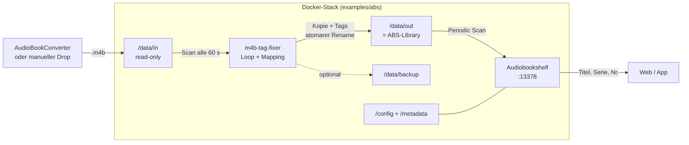
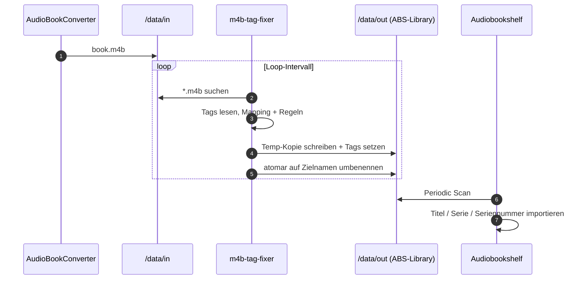

# Architektur

## 1. Überblick

`m4b-tag-fixer` ist ein Batch-Prozessor für `.m4b`-Dateien. Er liest MP4-Tags,
berechnet Mappings und Wert-Ersetzungen im Speicher und schreibt das Ergebnis in
eine Kopie. Die Audiodaten werden nicht neu codiert.

Das Tool ist bewusst klein gehalten:

- keine Datenbank
- kein Daemon-Framework
- kein HTTP-Server
- kein ABS-API-Zugriff
- kein Eingriff in die ABS-Datenbank

## 2. Komponenten

| Modul | Aufgabe |
| --- | --- |
| `src/m4b_tag_fixer/config.py` | Defaults, Env/YAML/CLI, Validierung, Default-Mapping |
| `src/m4b_tag_fixer/metadata.py` | MP4-Atome lesen/schreiben, Tag-Normalisierung, Mapping, Regeln |
| `src/m4b_tag_fixer/processor.py` | Dateisuche, Zielpfade, Backup, Kopie, atomarer Rename |
| `src/m4b_tag_fixer/main.py` | CLI, Logging, Loop-Modus, Exit-Codes |
| `src/main.py` | direkter Einstieg über `python src/main.py` |

## 3. Systemfluss

Der Ausgabeordner ist im ABS-Stack bewusst identisch mit der ABS-Library. Der
Eingangsordner bleibt read-only und wird von ABS nicht gesehen.

## 4. Ablauf pro Datei

Konkret:

1. Dateien unter `INPUT_DIR` suchen (`*.m4b`, optional rekursiv).
2. Zielpfad bestimmen (flach, gespiegelt, Same-Dir oder In-Place).
3. Vorhandene Ausgabedatei prüfen und ggf. überspringen.
4. Optional die Quelle nach `BACKUP_DIR` sichern.
5. Tags der Quelle lesen.
6. Mappings und Wert-Ersetzungen im Speicher anwenden.
7. Quelle in eine Temp-Datei im Zielverzeichnis kopieren.
8. Tags in der Temp-Datei schreiben.
9. Temp-Datei atomar auf den Zielnamen verschieben.
10. Optional alte Backups gemäß `BACKUP_RETENTION_DAYS` bereinigen.

## 5. MP4-Atome

`.m4b` ist ein MPEG-4-Container. Die Metadaten liegen in MP4-Atomen, nicht in
ID3-Frames. Deshalb verwendet das Tool `mutagen.mp4.MP4`.

| Logisch | MP4-Atome | ffprobe ohne `-export_all` | ABS |
| --- | --- | --- | --- |
| `series` | `tvsh`, `mvnm` | `show` | Series |
| `series-part` | `tven`, `mvin` | `episode_id` | Series Sequence |
| `album` | `©alb` | `album` | Buchtitel |
| `title` | `©nam` | `title` | Titel |
| `artist` | `©ART` | `artist` | Autor |
| `composer` | `©wrt` | `composer` | Sprecher (typisch) |

Beim Lesen haben `tvsh`/`tven` Vorrang vor `mvnm`/`mvin`. Dadurch bleiben ältere
Ausgabedateien kompatibel. `mvin` wird als echtes Integer-Atom geschrieben,
`tven` als Text.

## 6. Idempotenz und Sicherheit

- **Standardmodus:** Die Quelle wird nie verändert; geschrieben wird eine Kopie.
- **Vorhandene Ausgabe:** Bei `OVERWRITE_EXISTING=false` wird die Datei
  übersprungen. Das ist der wichtigste Idempotenz-Schutz im Loop.
- **Suffix:** `OUTPUT_SUFFIX=true` hängt `RENAME_SUFFIX` an und verhindert
  Kollisionen; `SKIP_SUFFIX=true` überspringt bereits suffixed Dateien.
- **Atomarer Rename:** Geschrieben wird zunächst in eine Temp-Datei im
  Zielverzeichnis; erst nach Erfolg wird sie auf den Zielnamen verschoben.
- **Backup:** Optional; schützt vor Datenverlust, kostet aber eine vollständige
  Dateikopie.
- **In-Place:** Nur mit `OVERWRITE_SOURCE_FILE=true`. Ein Backup ist dringend
  empfohlen, aber nicht Pflicht. Im Loop wird die Datei bei jedem Durchlauf
  erneut verarbeitet.

## 7. Grenzen

- Jede verarbeitete Datei wird vollständig kopiert.
- Bei `moov` vor `mdat` kann eine Tag-Vergrößerung den `mdat`-Block verschieben.
- Kein Move-Modus: Quelldateien werden nicht gelöscht oder verschoben.
- Kein Reflink/CoW-Support.
- Kein automatischer ABS-Scan; ABS muss periodisch oder manuell scannen.
- Kein echter ABS-Integrationstest in der Testsuite.

## 8. Weiterführend

- [`PROBLEM.md`](PROBLEM.md) – warum das Tag-Rewriting nötig ist
- [`CONFIGURATION.md`](CONFIGURATION.md) – alle Optionen
- [`OPERATIONS.md`](OPERATIONS.md) – Docker, Backup, Troubleshooting
- [`../SPEC.md`](../SPEC.md) – Abnahmekriterien
