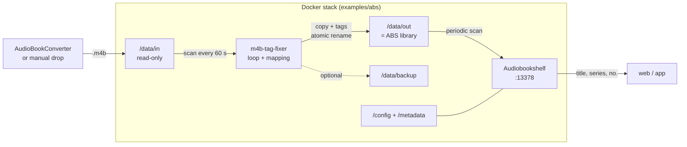
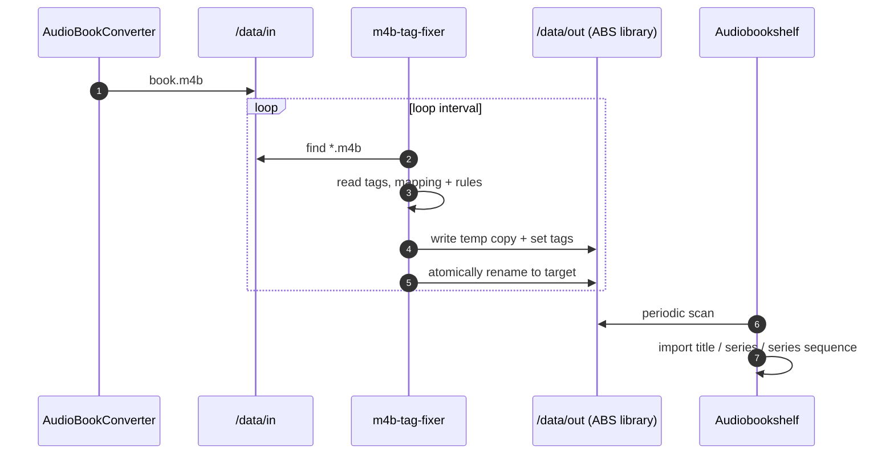

# Architecture

## 1. Overview

`m4b-tag-fixer` is a batch processor for `.m4b` files. It reads MP4 tags,
computes mappings and value replacements in memory, and writes the result to a
copy. Audio data is never re-encoded.

The tool is intentionally small:

- no database
- no daemon framework
- no HTTP server
- no ABS API access
- no changes to the ABS database

## 2. Components

| Module | Responsibility |
| --- | --- |
| `src/m4b_tag_fixer/config.py` | Defaults, environment/YAML/CLI, validation, default mapping |
| `src/m4b_tag_fixer/metadata.py` | Read/write MP4 atoms, tag normalization, mappings, rules |
| `src/m4b_tag_fixer/processor.py` | File discovery, target paths, backup, copy, atomic rename |
| `src/m4b_tag_fixer/main.py` | CLI, logging, loop mode, exit codes |
| `src/main.py` | direct entry point via `python src/main.py` |

## 3. System Flow

In the ABS stack, the output folder is intentionally the same as the ABS library.
The input folder remains read-only and is never seen by ABS.

## 4. Per-File Flow

Concretely:

1. Find files under `INPUT_DIR` (`*.m4b`, optionally recursive).
2. Determine the target path (flat, mirrored, same-directory, or in-place).
3. Check for an existing output file and skip it if configured.
4. Optionally back up the source to `BACKUP_DIR`.
5. Read the source tags.
6. Apply mappings and value replacements in memory.
7. Copy the source to a temp file in the target directory.
8. Write tags to the temp file.
9. Atomically rename the temp file to the target name.
10. Optionally clean up old backups according to `BACKUP_RETENTION_DAYS`.

## 5. MP4 Atoms

`.m4b` is an MPEG-4 container. Metadata is stored in MP4 atoms, not ID3 frames.
The tool therefore uses `mutagen.mp4.MP4`.

| Logical | MP4 atoms | ffprobe without `-export_all` | ABS |
| --- | --- | --- | --- |
| `series` | `tvsh`, `mvnm` | `show` | Series |
| `series-part` | `tven`, `mvin` | `episode_id` | Series Sequence |
| `album` | `©alb` | `album` | Book title |
| `title` | `©nam` | `title` | Title |
| `artist` | `©ART` | `artist` | Author |
| `composer` | `©wrt` | `composer` | Narrator (typical) |

When reading, `tvsh`/`tven` take precedence over `mvnm`/`mvin`. This keeps older
output files compatible. `mvin` is written as a real integer atom, while `tven`
is written as text.

## 6. Idempotency and Safety

- **Default mode:** The source is never modified; a copy is written.
- **Existing output:** With `OVERWRITE_EXISTING=false`, the file is skipped. This
  is the main idempotency guard in loop mode.
- **Suffix:** `OUTPUT_SUFFIX=true` appends `RENAME_SUFFIX` and avoids collisions;
  `SKIP_SUFFIX=true` skips files that already carry the suffix.
- **Atomic rename:** Data is first written to a temp file in the target directory
  and only moved to the target name after success.
- **Backup:** Optional; protects against data loss but requires a full file copy.
- **In-place:** Only with `OVERWRITE_SOURCE_FILE=true`. A backup is strongly
  recommended but not mandatory. In loop mode, the file is processed again on
  every pass.

## 7. Limits

- Every processed file is copied in full.
- If `moov` precedes `mdat`, growing a tag can shift the `mdat` block.
- No move mode: source files are neither deleted nor moved.
- No reflink/CoW support.
- No automatic ABS scan; ABS must scan periodically or manually.
- No real ABS integration test in the test suite.

## 8. Further Reading

- [`PROBLEM.md`](PROBLEM.md) – why tag rewriting is necessary
- [`CONFIGURATION.md`](CONFIGURATION.md) – all options
- [`OPERATIONS.md`](OPERATIONS.md) – Docker, backup, troubleshooting
- [`../SPEC.md`](../SPEC.md) – acceptance criteria
