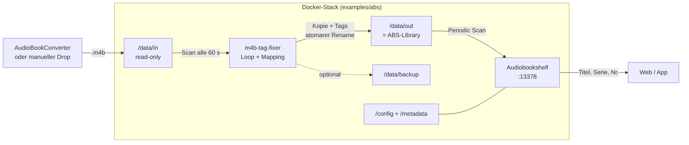

# m4b-tag-fixer

> **Archived German README snapshot (2026-10-21). Not maintained.**
> The current documentation is maintained in English in the repository root.

[](https://github.com/yasuoiwakura/audiobook-tag-rewriter/actions/workflows/docker.yml)
[](https://github.com/yasuoiwakura/audiobook-tag-rewriter/pkgs/container/audiobook-tag-rewriter)
[](../../LICENSE)
[](https://www.python.org/)

`m4b-tag-fixer` ist ein Batch-CLI-Tool, das MP4-Metadaten in `.m4b`-Hörbuchdateien
so aufbereitet, dass **Audiobookshelf (ABS)** Titel, Autor, Sprecher, Serie und
Seriennummer korrekt importiert. Es ist als Vorverarbeitungsschritt für
**AudioBookConverter**-Ausgaben gedacht.

Das Projekt heißt `m4b-tag-fixer`; das veröffentlichte Container-Image heißt
`audiobook-tag-rewriter`.

- [Das Problem](#das-problem)
- [Die Lösung](#die-lösung)
- [Quick Start](#quick-start)
- [Audiobookshelf-Stack](#audiobookshelf-stack)
- [Architektur](#architektur)
- [Konfiguration](#konfiguration)
- [Betrieb](#betrieb)
- [Grenzen und Sicherheit](#grenzen-und-sicherheit)
- [Entwicklung](#entwicklung)
- [Dokumentation](#dokumentation)
- [Support](#support)
- [Lizenz](#lizenz)

## Das Problem

AudioBookConverter schreibt Serienhörbücher typischerweise mit dieser Semantik:

- `album` = Serie
- `track` = Seriennummer
- `title` = Buchtitel

Audiobookshelf interpretiert bei M4B dagegen `album` als Buchtitel und `track`
als Track/Kapitel. Serie und Seriennummer wertet der ffprobe-basierte Scanner nur
über `show` und `episode_id` aus, die aus den MP4-Atomen `tvsh` und `tven`
stammen.

Zusätzlich ruft ABS ffprobe **ohne** `-export_all` auf. Dadurch sind die
eigentlich passenden Atome `mvnm`/`mvin` bei MP4/M4B für ABS unsichtbar. Das
Ergebnis: falscher Buchtitel, leere Serie, leere Seriennummer.

Die vollständige Problem-, Ursachen- und Alternativenanalyse steht in
[`doc/PROBLEM.md`](../../doc/PROBLEM.md). Der Upstream-Issue-Entwurf liegt in
[`ABS-issue-readtags.md`](../../ABS-issue-readtags.md).

## Die Lösung

Der Fixer kopiert die Datei und schreibt die Tags um. Die Audiodaten werden nicht
neu codiert.

Ohne `TAG_MAP` und ohne `TAG_RULES` gilt dieses Default-Mapping:

| Quelle | Ziel | MP4-Atome | Bedeutung |
| --- | --- | --- | --- |
| `album` | `series` | `tvsh`, `mvnm` | Album wird als Serie übernommen |
| `track` | `series-part` | `tven`, `mvin` | Tracknummer wird zur Seriennummer |
| `title` | `album` | `©alb` | Buchtitel wird als Album gesetzt |

`tvsh`/`tven` sind für ABS und ffprobe sichtbar (`show`/`episode_id`).
`mvnm`/`mvin` werden zusätzlich geschrieben, damit andere Player sie finden.
`mvin` bleibt ein echtes Integer-Atom.

Wichtig:

- Mappings **kopieren** Werte; die Quelle bleibt erhalten, das Ziel wird
  überschrieben. `title -> album` überschreibt also bewusst das bisherige Album,
  nachdem es zuvor nach `series` kopiert wurde.
- Das Default-Mapping ist für AudioBookConverter-Dateien gedacht. Bei anderen
  Quellen kann es unpassend sein.
- Default deaktivieren: `TAG_MAP=[]` (bzw. `tag_map: []` in YAML).
- Nur `TAG_RULES` gesetzt? Dann gilt **kein** Default-Mapping.
- Mappings laufen immer **vor** den Wert-Ersetzungen.

### MP4-Metadaten, keine ID3-Frames

`.m4b`-Dateien sind MPEG-4-Container. Die Metadaten liegen in MP4-Atomen wie
`©alb`, `©ART`, `©nam`, `aART`, `trkn`, `©day`, `©gen`, `tvsh`, `tven`, `mvnm`
und `mvin` – nicht in klassischen ID3-Frames. Deshalb verwendet das Tool
`mutagen.mp4.MP4`, nicht `mutagen.id3`. Details:
[`doc/ARCHITECTURE.md`](../../doc/ARCHITECTURE.md).

## Quick Start

Voraussetzungen: Docker mit Docker Compose **≥ 2.24**.

```bash
mkdir -p m4b_from_AudioBookConverter m4b_for_AudioBookShelf m4b_backup config
docker compose up --build
```

PowerShell:

```powershell
New-Item -ItemType Directory -Force m4b_from_AudioBookConverter, m4b_for_AudioBookShelf, m4b_backup, config | Out-Null
docker compose up --build
```

Dateien in `m4b_from_AudioBookConverter` legen. Der Fixer läuft im Loop
(`LOOP=true`, `LOOP_INTERVAL=60`) und schreibt nach `m4b_for_AudioBookShelf`.

Fertiges GHCR-Image verwenden:

```bash
docker compose pull
docker compose up --no-build
```

Einmalig statt Loop:

```bash
LOOP=false docker compose up --build
```

PowerShell:

```powershell
$env:LOOP='false'; docker compose up --build
```

Nur ein Durchlauf mit Exit-Code:

```bash
docker compose run --rm -e LOOP=false m4b-tag-fixer
```

Lokaler Python-Aufruf:

```bash
pip install -r requirements.txt
python src/main.py --input-dir ./in --output-dir ./out
```

Alternativ `PYTHONPATH=src python -m m4b_tag_fixer ...`. Unter Windows setzt
`run.bat` dies automatisch und nutzt standardmäßig den Same-Dir-Modus.

## Audiobookshelf-Stack

Für Fixer und ABS als **einen Stack** gibt es
[`examples/abs/`](../../examples/abs/README.md):

```bash
cd examples/abs
cp .env.example .env
mkdir -p data/in data/out data/backup abs/config abs/metadata config
docker compose up -d --build
```

PowerShell:

```powershell
Set-Location examples/abs
Copy-Item .env.example .env
New-Item -ItemType Directory -Force data/in, data/out, data/backup, abs/config, abs/metadata, config | Out-Null
docker compose up -d --build
```

Der Fixer schreibt nach `data/out`; ABS mountet genau diesen Ordner als
`/audiobooks`. Der Eingangsordner `data/in` bleibt read-only und wird von ABS
nicht gesehen.

- ABS-Library auf `/audiobooks` anlegen.
- **Periodic Scan** aktivieren oder manuell scannen.
- „Watch for file changes“ in ABS deaktivieren: Die ABS-Doku warnt bei externen
  Tools, die Dateien in der Library verändern.
- Im Beispiel ist `REPLICATE_SOURCE_DIR_STRUCTURE=true` gesetzt, weil ABS eine
  Struktur mit einem Ordner pro Buch erwartet.

Der Ausgabeordner ist bewusst die ABS-Library. Ein direktes Überschreiben der
ABS-Library über `OVERWRITE_SOURCE_FILE=true` ist möglich, aber nicht der
Standard: Es gibt keinen Idempotenz-Marker, der Loop würde Dateien wiederholt
schreiben, und ABS könnte währenddessen scannen.

## Architektur



Ablauf pro Datei: Tags lesen → Mappings/Regeln im Speicher anwenden → optional
Backup → Quelle in Temp-Datei kopieren → Tags schreiben → atomar umbenennen.
Details und Sequenzdiagramm: [`doc/ARCHITECTURE.md`](../../doc/ARCHITECTURE.md).

## Konfiguration

Präzedenz: Defaults < YAML < `.env`/Env < CLI.

| Variable | Default | Bedeutung |
| --- | --- | --- |
| `INPUT_DIR` | `/in` | Eingabeverzeichnis |
| `OUTPUT_DIR` | `/out` | Ausgabeverzeichnis |
| `TAG_MAP` | – | JSON-Liste von Tag-Mappings |
| `TAG_RULES` | – | JSON-Liste von Wert-Ersetzungen |
| `REPLICATE_SOURCE_DIR_STRUCTURE` | `false` | Quellstruktur unter `OUTPUT_DIR` spiegeln |
| `LOOP` | `false` | Dauerbetrieb (Compose: `true`) |
| `BACKUP` | `false` | Eingabedatei vor der Verarbeitung sichern |
| `OVERWRITE_SOURCE_FILE` | `false` | Quelle in-place überschreiben; Backup empfohlen |
| `LOG_LEVEL` | `INFO` | `DEBUG`, `INFO`, `WARNING`, `ERROR`, ... |

Alle Optionen, YAML, CLI, `TAG_MAP`, `TAG_RULES`, unterstützte Tags und die
Suffix-/Overwrite-Matrix: [`doc/CONFIGURATION.md`](../../doc/CONFIGURATION.md).

## Betrieb

- Im Compose-Betrieb läuft der Container standardmäßig im Loop und bleibt als
  Dienst aktiv.
- `BACKUP=true` kopiert die Eingabedatei vollständig nach `BACKUP_DIR`; alte
  Backups werden nach `BACKUP_RETENTION_DAYS` bereinigt.
- Vorhandene Ausgabedateien werden bei `OVERWRITE_EXISTING=false` übersprungen.
- Geschrieben wird zuerst in eine Temp-Datei und danach atomar umbenannt.
- Same-Dir/In-Place benötigen ein beschreibbares `/data/in`; das Standard-Compose
  mountet es read-only.
- Auf Linux müssen Ausgabe und Backup für UID 1000 schreibbar sein.
- Fehler einzelner Dateien stoppen den Batch nicht.

Docker-Details, Mounts, Permissions, Exit-Codes, GHCR und Troubleshooting:
[`doc/OPERATIONS.md`](../../doc/OPERATIONS.md).

## Grenzen und Sicherheit

- Jede verarbeitete Datei wird vollständig kopiert, auch ohne Tag-Änderungen.
- Kein Re-Encoding der Audiodaten.
- Kein Move-Modus: Quelldateien werden nicht gelöscht oder verschoben.
- In-Place-Overwrite ist möglich, aber im Loop nicht idempotent.
- Kein automatischer ABS-Scan; ABS muss periodisch oder manuell scannen.
- Das Default-Mapping ist auf AudioBookConverter-Ausgaben ausgelegt.
- `.env` und `override.env` nicht committen; Backups enthalten vollständige
  Hörbücher.

Bekannte Einschränkungen und Messwerte: [`SPEC.md`](../../SPEC.md).

## Entwicklung

```bash
python -m venv .venv
pip install -r requirements-dev.txt
pytest
ruff check src tests
```

Die Tests erzeugen synthetische MP4/M4B-Dateien mit echten mutagen-Tags; es werden
keine realen Hörbücher benötigt. Beiträge, Projektstruktur und PR-Checkliste:
[`CONTRIBUTING.md`](../../CONTRIBUTING.md).

## Dokumentation

| Dokument | Inhalt |
| --- | --- |
| [`doc/PROBLEM.md`](../../doc/PROBLEM.md) | Problem, Ursache, Entscheidung, Alternativen |
| [`doc/ARCHITECTURE.md`](../../doc/ARCHITECTURE.md) | Komponenten, Ablauf, Idempotenz |
| [`doc/CONFIGURATION.md`](../../doc/CONFIGURATION.md) | Env, YAML, CLI, Tags, Regeln |
| [`doc/OPERATIONS.md`](../../doc/OPERATIONS.md) | Docker, Backup, Troubleshooting |
| [`SPEC.md`](../../SPEC.md) | Implementierungsstand und Abnahmekriterien |
| [`doc/FEATURES/`](../../doc/FEATURES/README.md) | Feature-Inventar und Konventionen |
| [`ABS-issue-readtags.md`](../../ABS-issue-readtags.md) | Upstream-Issue-Entwurf (englisch) |
| [`examples/abs/`](../../examples/abs/README.md) | Fixer + Audiobookshelf als ein Stack |

## Support

Fehler und Feature-Wünsche bitte über
[GitHub Issues](https://github.com/yasuoiwakura/audiobook-tag-rewriter/issues)
melden. Bitte keine Hörbuchdateien, Backups oder Zugangsdaten anhängen.

## Lizenz

MIT – siehe [`LICENSE`](../../LICENSE).

Danke an [AudioBookConverter](https://github.com/yermak/AudioBookConverter),
[Audiobookshelf](https://github.com/advplyr/audiobookshelf) und
[mutagen](https://mutagen.readthedocs.io/).
