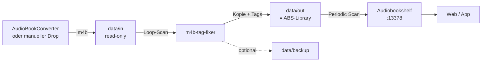

# Fixer + Audiobookshelf als ein Stack

Dieses Beispiel startet `m4b-tag-fixer` und Audiobookshelf (ABS) gemeinsam.
Der Fixer liest aus `data/in` und schreibt nach `data/out`; genau `data/out` wird
in ABS als `/audiobooks` gemountet. Der Eingangsordner bleibt read-only und wird
von ABS nicht gesehen.



## 1. Voraussetzungen

- Docker mit Docker Compose **≥ 2.24** (`env_file.required`)
- Port `13378` frei, oder `ABS_PORT` in `.env` ändern
- Auf Linux: UID 1000 muss in `data/out` und `data/backup` schreiben dürfen

## 2. Start

```bash
# im Repository-Root
cd examples/abs

cp .env.example .env
# optional: cp override.env.example override.env

mkdir -p data/in data/out data/backup abs/config abs/metadata config
docker compose up -d --build
```

PowerShell:

```powershell
Set-Location examples/abs
Copy-Item .env.example .env
# optional: Copy-Item override.env.example override.env
New-Item -ItemType Directory -Force data/in, data/out, data/backup, abs/config, abs/metadata, config | Out-Null
docker compose up -d --build
```

Lokaler Build verwenden:

```bash
docker compose up -d --build
```

Veröffentlichtes GHCR-Image verwenden:

```bash
docker compose pull
docker compose up -d --no-build
```

Logs:

```bash
docker compose logs -f m4b-tag-fixer
docker compose logs -f audiobookshelf
```

ABS öffnen: <http://localhost:13378>

## 3. Audiobookshelf einrichten

1. Beim ersten Start Admin-Benutzer anlegen.
2. Library anlegen, z. B. „Audiobooks“.
3. Ordner: `/audiobooks`.
4. Media-Type: Books.
5. **„Watch for file changes“ deaktivieren.** Die ABS-Dokumentation warnt davor,
   externe Tools gleichzeitig auf die Library schreiben zu lassen.
6. **Periodic Scan** aktivieren, z. B. alle 15 Minuten, oder manuell scannen.

Der Fixer schreibt vollständige Dateien und benennt sie atomar um; ABS sieht
dadurch keine halb geschriebenen Dateien. Ein automatischer Scan-Trigger nach
jedem Fixer-Lauf ist nicht implementiert.

## 4. Dateien verarbeiten

1. `.m4b`-Datei nach `data/in` legen.
2. Fixer wartet standardmäßig bis zu 60 Sekunden (`LOOP_INTERVAL`).
3. Ergebnis erscheint unter `data/out`.
4. ABS scannt periodisch oder manuell.

Einmal-Lauf statt Loop:

```bash
docker compose run --rm -e LOOP=false m4b-tag-fixer
```

## 5. Verzeichnisstruktur

ABS erwartet eine Struktur mit einem Ordner pro Buch. Deshalb setzt
`upstream.env` in diesem Beispiel:

```dotenv
REPLICATE_SOURCE_DIR_STRUCTURE=true
```

Beispiel:

```text
data/in/Autor/Serie/Band 1/book.m4b
  -> data/out/Autor/Serie/Band 1/book.m4b
```

Wenn die Eingabe flach ist, bleibt auch die Ausgabe flach. Für ABS ist eine
Ordnerstruktur pro Buch trotzdem empfehlenswert.

## 6. Konfiguration

- `upstream.env` – committed Defaults für den Fixer
- `override.env` – optionale App-Overrides (ignored)
- `.env` – Compose-Interpolation: Host-Pfade, Ports, TZ, Image-Tags

Wichtige Defaults:

| Variable | Wert |
| --- | --- |
| `LOOP` | `true` |
| `LOOP_INTERVAL` | `60` |
| `BACKUP` | `true` |
| `REPLICATE_SOURCE_DIR_STRUCTURE` | `true` |
| `OVERWRITE_EXISTING` | `false` |
| `OVERWRITE_SOURCE_FILE` | `false` |

`BACKUP=true` kostet eine vollständige Dateikopie pro Eingabedatei. Mit
`BACKUP=false` in `override.env` lässt sich das abschalten.

Alle Optionen: [`../../doc/CONFIGURATION.md`](../../doc/CONFIGURATION.md).

## 7. Linux-Permissions

Der Fixer-Container läuft als UID 1000. Auf Linux:

```bash
mkdir -p data/in data/out data/backup abs/config abs/metadata config
sudo chown -R 1000:1000 data/out data/backup
```

Wenn ABS mit `user: "1000:1000"` läuft, müssen auch `abs/config`,
`abs/metadata` und `data/out` für UID 1000 schreibbar sein.

## 8. Warum nicht direkt in die ABS-Library schreiben?

`OVERWRITE_SOURCE_FILE=true` könnte die Library direkt bearbeiten. Für diesen
Stack ist das nicht der Standard:

- kein Idempotenz-Marker außer der Datei selbst
- im Loop würde jede Datei bei jedem Durchlauf neu geschrieben
- ABS könnte während des Schreibens scannen
- Quelle und Bibliothek wären nicht getrennt
- ein Fehler würde die Bibliothek direkt treffen

Der Separate-Output-Modus mit `OVERWRITE_EXISTING=false` verhindert
Wiederholungsarbeit und hält die Quelle unverändert.

## 9. Troubleshooting

### ABS zeigt falsche Tags

- Library-Ordner prüfen: `/audiobooks`, nicht `/data/in`.
- Library erneut scannen.
- Datei mit ffprobe prüfen:
  ```bash
  ffprobe -v quiet -show_entries format_tags -of json -- "book.m4b"
  ```
- `show` und `episode_id` sollten gesetzt sein.

### Keine Datei in `data/out`

- Logs prüfen: `docker compose logs -f m4b-tag-fixer`.
- `FILENAME_FILTER` und `.m4b`-Endung prüfen.
- Bei Unterordnern: `REPLICATE_SOURCE_DIR_STRUCTURE=true` (hier Default).
- Bei bereits vorhandener Ausgabe: `OVERWRITE_EXISTING=true` oder Datei
  entfernen.

### Permission denied

- `data/out` und `data/backup` für UID 1000 schreibbar machen.
- Same-Dir/In-Place benötigt ein beschreibbares `data/in`; hier ist es
  read-only.

### ABS erkennt neue Bücher nicht

- Periodic Scan aktivieren oder manuell scannen.
- File Watcher nur mit der ABS-Warnung zu externen Tools verwenden.

## 10. Stoppen und Aufräumen

```bash
docker compose down
```

Die Daten bleiben in `data/` und `abs/` erhalten. Zum vollständigen Entfernen
diese Verzeichnisse bewusst löschen.
