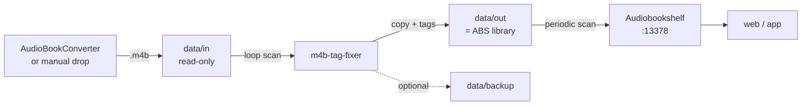

# Fixer + Audiobookshelf as One Stack

This example starts `m4b-tag-fixer` and Audiobookshelf (ABS) together. The fixer
reads from `data/in` and writes to `data/out`; exactly `data/out` is mounted into
ABS as `/audiobooks`. The input folder remains read-only and is not visible to
ABS.



## 1. Requirements

- Docker with Docker Compose **≥ 2.24** (`env_file.required`)
- Port `13378` available, or change `ABS_PORT` in `.env`
- On Linux: UID 1000 must be able to write to `data/out` and `data/backup`

## 2. Start

```bash
# from the repository root
cd examples/abs

cp .env.example .env
# optional: cp override.env.example override.env

mkdir -p data/in data/out data/backup abs/config abs/metadata config
docker compose up -d --build
```

PowerShell:

```powershell
Set-Location examples/abs
Copy-Item .env.example .env
# optional: Copy-Item override.env.example override.env
New-Item -ItemType Directory -Force data/in, data/out, data/backup, abs/config, abs/metadata, config | Out-Null
docker compose up -d --build
```

Use a local build:

```bash
docker compose up -d --build
```

Use the published GHCR image:

```bash
docker compose pull
docker compose up -d --no-build
```

Logs:

```bash
docker compose logs -f m4b-tag-fixer
docker compose logs -f audiobookshelf
```

Open ABS: <http://localhost:13378>

## 3. Configure Audiobookshelf

1. Create the admin user on first start.
2. Create a library, for example “Audiobooks”.
3. Folder: `/audiobooks`.
4. Media type: Books.
5. **Disable “Watch for file changes”.** The ABS documentation warns against
   letting external tools write to the library at the same time.
6. Enable **periodic scans**, for example every 15 minutes, or scan manually.

The fixer writes complete files and renames them atomically, so ABS never sees
partially written files. An automatic scan trigger after each fixer pass is not
implemented.

## 4. Process Files

1. Place an `.m4b` file in `data/in`.
2. The fixer waits up to 60 seconds by default (`LOOP_INTERVAL`).
3. The result appears in `data/out`.
4. ABS scans periodically or manually.

Run once instead of in a loop:

```bash
docker compose run --rm -e LOOP=false m4b-tag-fixer
```

## 5. Directory Structure

ABS expects a structure with one folder per book. Therefore, `upstream.env` in
this example sets:

```dotenv
REPLICATE_SOURCE_DIR_STRUCTURE=true
```

Example:

```text
data/in/Author/Series/Volume 1/book.m4b
  -> data/out/Author/Series/Volume 1/book.m4b
```

If the input is flat, the output remains flat. For ABS, a folder structure per
book is still recommended.

## 6. Configuration

- `upstream.env` – committed fixer defaults
- `override.env` – optional app overrides (ignored)
- `.env` – Compose interpolation: host paths, ports, timezone, image tags

Important defaults:

| Variable | Value |
| --- | --- |
| `LOOP` | `true` |
| `LOOP_INTERVAL` | `60` |
| `BACKUP` | `true` |
| `REPLICATE_SOURCE_DIR_STRUCTURE` | `true` |
| `OVERWRITE_EXISTING` | `false` |
| `OVERWRITE_SOURCE_FILE` | `false` |

`BACKUP=true` costs one full file copy per input file. Set `BACKUP=false` in
`override.env` to disable it.

All options: [`../../doc/CONFIGURATION.md`](../../doc/CONFIGURATION.md).

## 7. Linux Permissions

The fixer container runs as UID 1000. On Linux:

```bash
mkdir -p data/in data/out data/backup abs/config abs/metadata config
sudo chown -R 1000:1000 data/out data/backup
```

If ABS runs with `user: "1000:1000"`, then `abs/config`, `abs/metadata`, and
`data/out` must also be writable by UID 1000.

## 8. Why Not Write Directly into the ABS Library?

`OVERWRITE_SOURCE_FILE=true` could modify the library directly. For this stack,
that is not the default:

- no idempotency marker other than the file itself
- in loop mode, every file would be rewritten on every pass
- ABS could scan while the file is being written
- source and library would not be separated
- an error would affect the library directly

Separate-output mode with `OVERWRITE_EXISTING=false` prevents repeated work and
keeps the source unchanged.

## 9. Troubleshooting

### ABS Shows Incorrect Tags

- Verify the library folder: `/audiobooks`, not `/data/in`.
- Scan the library again.
- Check the file with ffprobe:
  ```bash
  ffprobe -v quiet -show_entries format_tags -of json -- "book.m4b"
  ```
- `show` and `episode_id` should be set.

### No File in `data/out`

- Check the logs: `docker compose logs -f m4b-tag-fixer`.
- Check `FILENAME_FILTER` and the `.m4b` extension.
- For subfolders: `REPLICATE_SOURCE_DIR_STRUCTURE=true` (the default here).
- If output already exists: set `OVERWRITE_EXISTING=true` or remove the file.

### Permission Denied

- Make `data/out` and `data/backup` writable by UID 1000.
- Same-directory/in-place mode requires a writable `data/in`; here it is
  read-only.

### ABS Does Not Discover New Books

- Enable periodic scans or scan manually.
- Use the file watcher only if you accept the ABS warning about external tools.

## 10. Stop and Clean Up

```bash
docker compose down
```

Data remains in `data/` and `abs/`. To remove everything, delete those directories
deliberately.
